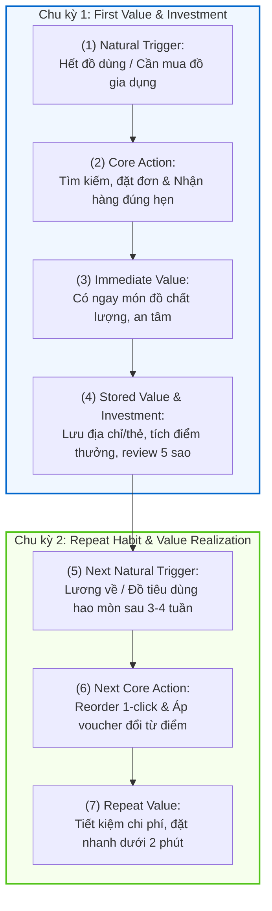

# METRICS PACK: E-COMMERCE MULTI-BRANCH PLATFORM

**Họ tên:** Chử Trần Phương Nam  
**Mã học viên (MHV):** 2A202602675  
**Dự án lựa chọn:** Hệ thống Thương mại Điện tử & Giao vận Đa Chi nhánh (E-Commerce Multi-Branch Platform — Olist Vietnam)

---

## 00 — DỰ ÁN, PERSONA, CORE JOB

### 1. Dự án
**E-Commerce Multi-Branch Retail & Fulfillment Platform (Olist Vietnam):** Nền tảng thương mại điện tử tích hợp chuỗi cung ứng đa chi nhánh (TP. Hồ Chí Minh, Hà Nội, Đà Nẵng), cho phép khách hàng tìm kiếm, đặt mua đa dạng sản phẩm và nhận hàng giao tận nơi thông qua mạng lưới vận chuyển tích hợp (GHN, GHTK, Viettel Post, VNPost).

### 2. Persona (Chỉ chọn 1 Persona chính)
* **Tên & Chân dung:** **Nguyễn Minh Anh (27 tuổi, Hà Nội / TP.HCM)** — Nhân viên văn phòng bận rộn, thu nhập trung bình khá.
* **Bối cảnh & Hành vi:** Thường xuyên mua sắm online các mặt hàng đồ gia dụng, thời trang, đồ dùng sinh hoạt cá nhân. Thời gian mua sắm chủ yếu rơi vào khung giờ nghỉ trưa (11h–13h) hoặc buổi tối sau giờ làm (sau 20h).
* **Đặc điểm tâm lý & Nỗi đau:** Đề cao tính đúng giờ, sự tin cậy và minh bạch. Rất thất vọng nếu đơn hàng bị giao trễ quá hạn cam kết, bị hủy ngầm, hoặc chất lượng sản phẩm thực tế không đúng như mô tả.

### 3. Core Job (Job-to-be-Done)
> *"Tôi muốn tìm và đặt mua các sản phẩm tiêu dùng/gia dụng đúng nhu cầu với chi phí hợp lý, thanh toán thuận tiện và nhận hàng giao tận nơi đúng hẹn, an toàn mà không phải mất thời gian theo dõi hay lo lắng về rủi ro giao trễ, hư hỏng."*

---

## 01 — CORE ACTION CARD

### 1. Phân biệt bốn khái niệm

| Khái niệm | Câu hỏi | Phân tích cụ thể cho dự án E-Commerce |
| :--- | :--- | :--- |
| **Core job** | User đang cố hoàn thành việc gì? | Tìm mua sản phẩm cần thiết và nhận hàng đúng hẹn, an toàn tại nhà. |
| **Core action** | User làm gì trong sản phẩm để tiến tới giá trị? | **Hoàn tất đặt đơn và nhận hàng giao thành công** (*Place Order & Receive Delivery*). |
| **Core value** | User nhận được lợi ích gì? | Tiết kiệm thời gian/công sức, sở hữu đúng sản phẩm mong muốn với trải nghiệm an tâm. |
| **Core value event** | Sự kiện nào chứng minh value đã xảy ra? | `order_delivered` (kèm xác nhận không phát sinh hoàn trả trong 7 ngày). |

### 2. Thẻ Core Action (Core Action Card)

| Thành phần | Câu trả lời của bạn |
| :--- | :--- |
| **Target user** | Khách hàng cá nhân mua sắm trực tuyến (Online Shopper - Nguyễn Minh Anh). |
| **Core job** | Mua sắm sản phẩm tiêu dùng/gia dụng tiện lợi, nhận hàng đúng hẹn và nguyên vẹn. |
| **Core action** | **Hoàn tất đặt đơn hàng và nhận kiện hàng giao thành công** (*Complete Order & Receive Delivery*). |
| **Object** | Đơn hàng (`Order` — gồm danh mục sản phẩm, địa chỉ nhận hàng và phương thức thanh toán). |
| **Preconditions** | Khách hàng đã chọn sản phẩm vào giỏ hàng, nhập địa chỉ nhận hàng, chọn phương thức thanh toán hợp lệ và xác nhận đặt mua. |
| **Completion rule** | Đơn hàng được đơn vị vận chuyển giao thành công đến tay khách hàng, trạng thái chuyển sang `delivered` và không phát sinh yêu cầu hoàn trả trong vòng 7 ngày. |
| **Core value** | Khách hàng nhận đúng món hàng chất lượng tại nhà đúng hạn, tiết kiệm thời gian di chuyển và an tâm về dịch vụ. |
| **Evidence of value** | Sự kiện `order_delivered` ghi nhận thành công, khách hàng không gửi khiếu nại hoàn đơn (`return_flag = FALSE`) và/hoặc gửi đánh giá `order_reviewed` từ 4–5 sao. |
| **Candidate event** | `order_delivered`, `order_completed`, `order_reviewed`. |

### 3. Tự kiểm 5 tiêu chí

| Tiêu chí | Kết quả | Phân tích & Lập luận |
| :--- | :---: | :--- |
| **1. Gần core value** | **ĐẠT** | Giá trị chỉ thực sự trọn vẹn khi khách nhận được món hàng trên tay. Nếu chỉ dừng ở "bấm mua" (`order_placed`) mà hàng bị trễ hay hủy thì chưa tạo ra giá trị. |
| **2. Có thể lặp lại** | **ĐẠT** | Nhu cầu mua sắm tiêu dùng, đồ gia dụng lặp lại theo chu kỳ tự nhiên (hàng tháng hoặc khi có nhu cầu mới). |
| **3. Có thể quan sát** | **ĐẠT** | Hệ thống backend và webhook logistics ghi nhận chính xác mốc thời gian `order_delivered_customer_date`. |
| **4. Có ý nghĩa** | **ĐẠT** | Số lượng đơn giao thành công tăng phản ánh trực tiếp sự tăng trưởng lành mạnh của nền tảng, không thể bị bóp méo như lượt xem hay lượt click. |
| **5. Có thể tác động** | **ĐẠT** | Đội ngũ sản phẩm và vận hành có thể tối ưu luồng xử lý đơn ca tối, thuật toán chọn kho gần nhất và sàng lọc đơn vị vận chuyển uy tín (GHN, GHTK, Viettel Post). |

---

## 02 — ACTION NATURE CARD & KẾT LUẬN CADENCE

### 1. Thẻ bản chất hành vi (Action Nature Card)

| Thành phần | Câu hỏi / Phân tích chi tiết |
| :--- | :--- |
| **Actor** | Khách hàng cá nhân (`user_id` / `customer_unique_id`). |
| **Intent** | Nhu cầu bổ sung đồ dùng sinh hoạt, đồ gia dụng, thời trang hoặc mua sắm phục vụ công việc/dịp lễ. |
| **Trigger** | **Internal Trigger:** Hết vật dụng trong nhà, nhận lương đầu tháng (Payday), nhu cầu đời sống phát sinh tự nhiên. |
| **Effort** | Trung bình 5–15 phút chọn sản phẩm, nhập voucher, kiểm tra địa chỉ và thanh toán. |
| **Value timing** | **Giá trị xuất hiện trễ (Delayed Value):** Sau 2–3 ngày vận chuyển khi đơn hàng được giao đến tận tay. |
| **State** | Địa chỉ giao hàng đã lưu, phương thức thanh toán mặc định, điểm tích lũy thành viên, lịch sử đơn hàng và gợi ý sở thích. |
| **Dependency** | Phụ thuộc vào tồn kho người bán, tốc độ đóng gói kho và SLA giao vận của đối tác vận chuyển. |
| **Repeat condition** | Đồ dùng đã mua sử dụng hết, phát sinh nhu cầu mới cho gia đình/bản thân, hoặc vào kỳ lương tháng tiếp theo. |

### 2. Kết luận Cadence

* **Dạng hành vi:** Tiến trình tích lũy theo chu kỳ tiêu dùng định kỳ (**Periodic Consumption & Progress Cycle**).
* **Kết luận Cadence:**
  > *"Đối với **nhân viên văn phòng bận rộn (Nguyễn Minh Anh)**, core action **đặt mua và nhận hàng giao thành công** thường xuất hiện **1–2 lần mỗi tháng (Monthly / Bi-weekly)** vì **đây là nhịp nhận lương, mua sắm bổ sung đồ gia dụng/nhu yếu phẩm và chu kỳ tiêu dùng tự nhiên của cá nhân/hộ gia đình**. Do đó, nhịp đo phù hợp là **Monthly (theo tháng)** ở cấp **User / Account**."*

---

## 03 — METRIC SYSTEM

### 1. Activation Metric
* **Start event:** `user_registered` (Khách hàng tạo tài khoản thành công).
* **Activation event:** `first_order_delivered` (Đơn hàng đầu tiên được giao thành công tới tay khách và không phát sinh khiếu nại hoàn trả trong 7 ngày).
* **Time window:** Trong vòng **14 ngày** kể từ `user_registered` (đủ thời gian cho phễu: Khám phá sản phẩm -> Đặt đơn -> Xử lý & Vận chuyển 2–3 ngày -> Nhận hàng & Trải nghiệm).
* **Công thức:**
  $$\text{Activation Rate (\%)} = \frac{\text{Số New Users hoàn tất first\_order\_delivered trong 14 ngày}}{\text{Tổng số New Users đăng ký trong Cohort}} \times 100\%$$

### 2. Engagement Metric (2 góc đo)
* **Frequency (Tần suất):** Số đơn hàng giao thành công trung bình trên mỗi khách hàng hoạt động trong tháng ($\text{Delivered Orders / Active Buyer / Month}$).
* **Depth (Độ sâu giá trị):** Giá trị đơn hàng trung bình ($\text{AOV - Average Order Value}$) và Doanh thu thuần trung bình trên mỗi khách hàng ($\text{ARPU}$).

### 3. North Star Metric (NSM)
* **Công thức:** $\text{Unit of Value} + \text{Quality Threshold} + \text{Frequency}$
* **Tên & Định nghĩa NSM:**
  $$\textbf{Monthly Satisfied \& On-Time Delivered Orders (MSODO)}$$
  *(Số lượng đơn hàng giao đúng hạn, nguyên vẹn và được khách hàng hài lòng mỗi tháng)*
* **Chi tiết 3 thành phần cấu thành:**
  1. **Unit of value:** Đơn hàng được giao thành công (`order_delivered`).
  2. **Quality threshold:** Đạt chuẩn SLA 3 yếu tố: Giao đúng hạn cam kết ($\text{Delivery Delay} \le 0$) + Không bị trả hàng (`return_flag = FALSE`) + Đánh giá review $\ge 4$ sao (hoặc không phát sinh khiếu nại).
  3. **Frequency:** Tổng hợp theo chu kỳ tháng (**Monthly**) khớp với nhịp Cadence tự nhiên.

### 4. Leading Indicators (Tối đa 3 chỉ số)
1. **Tỷ lệ đóng gói & bàn giao trong 24h ($\text{Fulfillment Speed} \le 24\text{h}$):** Đóng gói càng nhanh giúp giảm tổng thời gian giao hàng, trực tiếp kéo tăng tỷ lệ giao đúng hạn OTD và giảm tỷ lệ hủy đơn.
2. **Tỷ lệ giao hàng đúng hẹn của đối tác ($\text{On-Time Delivery Rate - OTD\%}$):** Dự báo trực tiếp mức độ hài lòng và xác suất quay lại mua sắm của khách hàng trong tháng kế tiếp.
3. **Tỷ lệ khách hàng quay lại đặt đơn trong 30 ngày ($\text{30-Day Repeat Purchase Rate}$):** Tín hiệu sớm cho thấy khách hàng đã hình thành thói quen mua sắm định kỳ sau trải nghiệm đơn đầu tiên.

### 5. Counter-Metric (Ít nhất 1 chỉ số)
1. **Tỷ lệ hoàn trả & khiếu nại đơn hàng ($\text{Return \& Dispute Rate}$):** Đảm bảo việc tăng tốc độ đóng gói và số lượng đơn không đánh đổi bằng việc đóng gói ẩu, giao sai/thiếu hàng hoặc hàng vỡ hỏng (Mục tiêu giữ $< 2.5\%$).
2. **Chi phí trợ giá vận chuyển trên mỗi đơn ($\text{Shipping Subsidy per Order}$):** Đảm bảo số lượng đơn tăng trưởng lành mạnh, không phụ thuộc vào việc trợ giá ship quá mức làm âm biên lợi nhuận ròng.

---

## 04 — RETENTION DEFINITION (6 THÀNH PHẦN)

### 1. Bảng định nghĩa Retention 6 thành phần

| Thành phần | Câu hỏi / Định nghĩa cụ thể cho dự án E-Commerce | Ghi chú & Lập luận |
| :--- | :--- | :--- |
| **1. Unit** | Khách hàng cá nhân (`user_id` / `customer_unique_id`). | Tính theo từng khách hàng duy nhất, không tính theo session hay device id. |
| **2. Cohort entry** | Thời điểm hoàn tất đơn hàng đầu tiên (`first_order_delivered`) trong tháng $M_0$. | Chỉ đưa vào cohort những user đã thực sự activated (nhận giá trị). |
| **3. Return event** | Hoàn tất ít nhất một đơn hàng giao thành công tiếp theo (`order_delivered` với `return_flag = FALSE`). | Phải là hành vi nhận giá trị thật, không tính hành vi mở app hay xem giỏ hàng. |
| **4. Window** | **Theo chu kỳ tháng (Monthly: M1, M2, M3, M6, M12)**. | Khớp chính xác 100% với kết luận Natural Cadence ở mục 02 (nhịp tiêu dùng 30 ngày). |
| **5. Threshold** | $\ge 1$ đơn hàng giao thành công trong window tháng. | Đủ để chứng minh nhu cầu mua sắm tiêu dùng định kỳ được duy trì. |
| **6. Segment** | • Khu vực địa lý chi nhánh (HCM, Hà Nội, Đà Nẵng). • Nhóm đối tác vận chuyển (GHN, GHTK, Viettel Post, VNPost). • Phân khúc khách hàng RFM (New, Potential, Loyal, Champions). | Cho phép phân tích nguyên nhân sâu (ví dụ: giao trễ tại HN/ĐN kéo tụt retention của nhánh đó). |

### 2. Đối chiếu với 3 mốc so sánh
* **Natural cycle:** Khớp với chu kỳ tiêu dùng tháng và dòng tiền lương của người đi làm.
* **Segment cohort:** Phân khúc *Champions/Loyal* tại HCM có M1 Retention đạt ~35–40%, trong khi nhóm *At-Risk* tại các khu vực giao trễ (HN/ĐN qua VNPost) chỉ đạt ~10–15%.
* **Category benchmark:** Ngành E-Commerce bán lẻ đa ngành có benchmark M1 Retention trung bình dao động từ **20% – 30%**.

---

## 05 — PRODUCT LOOP & METRIC HYPOTHESIS

### 1. Sơ đồ Product Loop 2 chu kỳ

* **Loại loop chính:** Vòng lặp tích lũy tiến trình và giá trị giữ lại (**Progress & Value Accumulation Loop**).
* **Reason to return nội tại (Không phụ thuộc Push Notification):**
  1. *Stored Value (Giá trị lưu trữ):* Khách hàng đã lưu sẵn địa chỉ, thông tin thanh toán -> Giảm ma sát đặt hàng lần sau chỉ còn 1-click.
  2. *Loyalty Points (Tài sản tích lũy):* Đơn hàng trước tạo ra điểm thưởng có thể giảm giá trực tiếp cho đơn hàng sau.
  3. *Personalized Recommendations:* Lịch sử mua hàng giúp trang chủ gợi ý đúng sản phẩm tiêu dùng định kỳ cần mua bổ sung.

### 2. Metric Hypothesis
> *"Nếu vòng lặp tích lũy giá trị (Progress & Stored Value Loop) này hoạt động hiệu quả, chỉ số **Monthly Retention Rate (M1, M2)** của nhóm khách hàng mới sẽ tăng từ **18% lên 28%** và **Average Order Value (AOV)** tăng thêm **15% trong vòng 2 quý (Q1–Q2/2025)**, vì khách hàng đã giảm triệt để ma sát thanh toán, có động lực tiêu dùng điểm thưởng tích lũy và hoàn toàn an tâm vào SLA giao hàng đúng hẹn."*

---

## 06 — TRACKING NHANH

### 1. Bảng Core Events (4–8 events dạng `object_action`)

| Tên Event | Ý nghĩa (Điều ĐÃ XẢY RA) | Thời điểm ghi nhận chính xác | Metric sử dụng |
| :--- | :--- | :--- | :--- |
| `order_placed` | Khách hàng đã thanh toán và tạo đơn hàng thành công trên hệ thống. | Ngay sau khi cổng thanh toán xác nhận giao dịch thành công / đơn COD được tạo. | Funnel Conversion Rate, Gross Orders, AOV. |
| `order_packed` | Kho chi nhánh đã hoàn tất đóng gói và dán nhãn vận đơn sẵn sàng bàn giao. | Nhân viên kho quét mã vạch hoàn tất đóng gói trên app nội bộ. | Fulfillment Speed ($\le 24\text{h}$ Leading Indicator). |
| `order_shipped` | Đơn vị vận chuyển (GHN/GHTK/Viettel Post) đã quét nhận kiện hàng từ kho. | Webhook từ đối tác vận chuyển xác nhận trạng thái `PICKED_UP`. | Handover SLA, Transit Time. |
| `order_delivered` | Khách hàng đã nhận được kiện hàng thành công và nguyên vẹn. | Webhook từ đối tác vận chuyển xác nhận trạng thái `DELIVERED_SUCCESS`. | **Core Action, Activation Rate, Retention Rate, NSM, OTD%.** |
| `order_returned` | Đơn hàng phát sinh yêu cầu hoàn trả và kho đã nhận lại hàng hoàn tất. | Khi kho xác nhận nhận lại kiện hàng hoàn trả `RETURN_RECEIVED`. | **Counter-metric: Return & Dispute Rate.** |
| `order_reviewed` | Khách hàng đã gửi điểm đánh giá (1–5 sao) và nhận xét cho đơn hàng. | Ngay khi user bấm nút gửi review trên ứng dụng và API trả về `200 OK`. | Quality Threshold cho NSM, CSAT Score. |

### 2. Tiêu chí nghiệm thu (Acceptance Criteria — $\ge 2$ tiêu chí)

* **Tiêu chí 1 (Chỉ ghi nhận khi hành vi thật sự hoàn tất):**
  > *"Với mỗi đơn hàng (`order_id`), hệ thống phân tích chỉ ghi nhận event `order_delivered` khi và chỉ khi hệ thống nhận webhook hợp lệ từ đối tác vận chuyển với trạng thái chuyển từ `in_transit` sang `delivered` kèm timestamp thực tế. Tuyệt đối không bắn event khi shipper mới ấn 'đang giao' hoặc khi khách hàng mở màn hình theo dõi đơn."*

* **Tiêu chí 2 (Chống ghi trùng do Retry / Webhook lặp):**
  > *"Hệ thống ingestion phải sử dụng khóa định danh duy nhất `idempotency_key = hash(order_id + event_name + status)`. Mọi request trùng lặp do mạng chập chờn, retry tự động từ webhook đối tác vận chuyển hoặc người dùng tải lại trang (reload) trong vòng 48h chỉ được xử lý đúng 1 lần (Exactly-Once Semantics), không được tạo thêm bản ghi mới trong database analytics."*

---

## REVISION (NHẬT KÝ ĐIỀU CHỈNH)

* **Điều chỉnh Core Action:** Ban đầu xem xét dùng `order_placed` (bấm mua), nhưng đã nâng cấp thành `order_delivered` (đặt đơn & nhận hàng thành công, không hoàn trả) để đảm bảo giá trị cốt lõi được nhận trọn vẹn.
* **Điều chỉnh Cadence:** Chuyển từ thói quen đo D7 sang **Monthly Cadence** (chu kỳ 30 ngày) để khớp với nhịp tiêu dùng sinh hoạt và dòng tiền lương thực tế của Persona Nguyễn Minh Anh.
